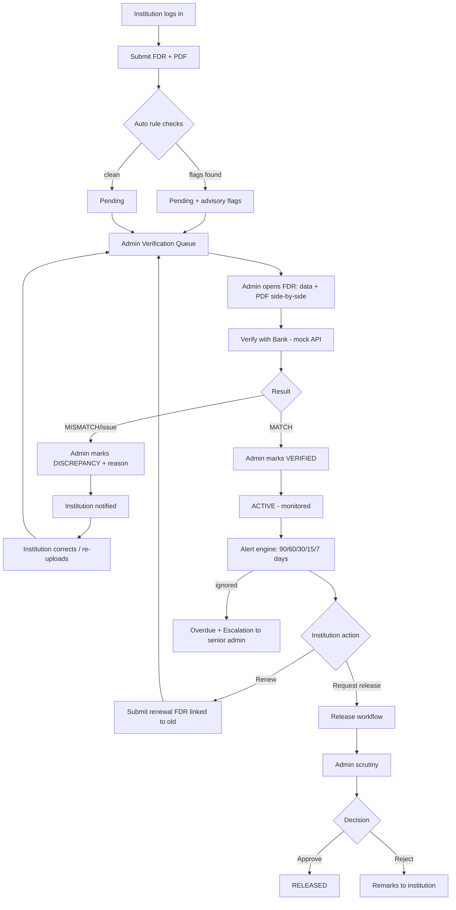

# 03 — APP FLOW

## 1. Site Map
```
/login
├── /admin  (AICTE Admin)
│   ├── Dashboard
│   ├── Institutions  → /admin/institutions/[id]  (profile + all FDRs + risk score)
│   ├── All FDRs      → /admin/fdrs/[id]          (detail + doc viewer + timeline)
│   ├── Verification Queue
│   ├── Release Requests
│   ├── Alerts
│   ├── Reports
│   ├── Audit Trail
│   └── Settings (alert rules)
└── /portal (Institution)
    ├── Dashboard
    ├── My FDRs → /portal/fdrs/new , /portal/fdrs/[id]
    ├── Release / Refund
    └── Alerts
```

## 2. Master Lifecycle Flow


## 3. Flow A — Institution Submits FDR
1. Login (Institution role) → `/portal` dashboard.
2. Click **"+ Submit New FDR"** (burnt-orange CTA).
3. Form (3-step stepper): **① Instrument details** (FDR/Ref No., Bank, Branch, Amount, Issue Date, Maturity Date, Purpose e.g. "Approval 2026-27") → **② Upload PDF** (drag-drop, size/type validation, preview) → **③ Review & Submit**.
4. On submit: validation → save → run rule engine → status `PENDING` → toast "Submitted. Awaiting AICTE verification" → redirect to FDR detail.
5. Detail page shows timeline: *Submitted ✓ → Under Review ○ → Verified ○*.

## 4. Flow B — Admin Verification
1. `/admin/verification` queue (sorted oldest first, SLA ageing chips: green <2d, yellow 2–5d, red >5d).
2. Open FDR → split view: left = submitted data (badge **Submitted**), right = PDF viewer.
3. Click **"Verify with Bank"** → loader → fields get **Bank-confirmed** (teal) or **Mismatch** (burnt-orange) badges.
4. Review advisory flags panel (rule engine results).
5. Add scrutiny remark (textarea) → choose **Mark Verified** or **Flag Discrepancy** (reason required).
6. System: status update, audit log, alert to institution.

## 5. Flow C — Automated Alerts
1. Admin clicks **Run Scan** (or auto on dashboard load).
2. Engine creates alerts per threshold; bell icon badge increments.
3. Admin Alerts page: tabs *Expiring · Overdue · Pending verification · Escalations*; mark read / open FDR.
4. Institution sees only their FDRs' alerts with a CTA "Renew now" / "Request release".
5. Unresolved > N days → Escalation alert to senior admin (red).

## 6. Flow D — Renewal
Institution on an EXPIRING FDR → **Renew** → pre-filled form with `renewalOf = oldFdrId` → submit → verification as Flow B → when new FDR VERIFIED, old FDR → `RENEWED`, history chain visible ("FDR-001 → FDR-014").

## 7. Flow E — Release / Refund
1. Institution opens a VERIFIED FDR → **Request Release** → select reason (Approval period completed / Course closure / Replacement / Other) + remarks + optional supporting doc.
2. Status tracker (stepper): Requested → Under Scrutiny → Approved → Released.
3. Admin `/admin/releases`: open request → checklist (FDR verified ✓, no open discrepancy ✓, conditions met ✓) → **Approve** / **Reject (remarks required)**.
4. On Approve → admin clicks **Mark Released** (records release date, reference) → FDR lifecycle `RELEASED`, alert sent.

## 8. Flow F — Audit Integrity
Admin → Audit Trail → table (time, actor, action, entity, hash short) → **Verify Chain Integrity** → green "Chain intact — N records verified" or red "Tampering detected at record #X". (Demo trick: manually edit a row in DB beforehand to show the red state.)

## 9. Navigation Rules
- Unauthenticated → `/login`. Wrong-role URL → redirect to own home.
- Sidebar active item uses yellow-orange left bar + lighter teal bg.
- Breadcrumbs on detail pages. Back preserves filters (URL query params).

## 10. Empty / Error States
| Screen | Empty | Error |
|---|---|---|
| FDR list | Illustration + "No FDRs yet — submit your first" | Retry card |
| Verification queue | "All caught up 🎉" | Retry |
| Alerts | "No active alerts" | Retry |
| Upload | — | Inline: "Only PDF up to 10 MB" |
